# COMP5424 Group 3 — Campus Emergency Preparedness

A VR fire evacuation preparedness practice prototype for international students at fictional Harbourview University. The experience supports practice rather than formal assessment and does not replace official emergency training.

## Final source version — 26 November 2026

**Version: [FINAL-20261126](https://github.com/RudeusLin/2026PolyU_COMP5424_Group3_CampusEmergencyPreparedness_VR/tree/FINAL-20261126)**. Open the XR scene in **Unity 2022.3.62f3** for Windows PC VR with Quest 3 through Link/Air Link and OpenXR.

- **Startup guidance:** language → route overview → localized controller guide → begin practice, with movement locked until confirmation.
- **Educational review:** six selectable steps with localized illustrations, explanations and cautions; restart or exit after review.
- **Right B menu:** pause, continue, restart or exit during practice; restart/exit require confirmation. Player position is fixed while modal panels are open.
- **Elevator warnings:** all four call panels explain why lifts must not be used during a fire; acknowledge to continue.
- **Smoke guidance:** localized grey haze near 401 and a framed, three-language warning facing Block B: wet the towel, then raise it with the left trigger before entering.

See the [final integration record and rollback instructions](Docs/Updates/Final_2026-11-26.md) and [current controls](Docs/XRControls.md). Editor and simulated-input checks passed; final headset comfort/readability and target-PC verification remain outstanding. The historical ZIP below has **not** been rebuilt for this source version.

## Phase 3 evaluation improvements — 22 November 2026

**Source baseline: [P3-20261122-01](https://github.com/RudeusLin/2026PolyU_COMP5424_Group3_CampusEmergencyPreparedness_VR/tree/P3-20261122-01)** (`6780b45`). Five initial anonymous questionnaires informed the following changes. The project owner has accepted the updated behaviour and presentation; formal participant retesting remains outstanding.

- **Safer stair teleportation:** destinations must follow supported, connected stair flights and landings. Peripheral platforms and direct whole-storey drops are rejected; use the intermediate landing when descending.
- **Side-exit completion:** the main entrance and side exits A/B each have three fires. After wheelchair assistance, guidance still defaults to the main entrance. Clear a side exit and actually cross outward to switch guidance to the assembly point; the simulated 999 task can then complete without clearing the main-entrance fires.
- **Clearer wheelchair assistance:** the chair stays about 1.4 m ahead and 0.25 m left, with safe positioning checks and rays passing through the escorted model. In the 2F refuge, aim at the green floor marker or downward arrow in the far-left corner, viewed from the doorway, and press **right A**. The chair parks automatically facing the door. A bench and supplies cabinet leave the central approach clear.
- **More visible instructions:** task and door cards use nearby upright surfaces, teal frames and a peripheral information cue. Outdoor guidance uses signboards. The three localized route images now show wheelchair assistance and exit firefighting explicitly.

Further work covers clearer next-step/completion explanations, a complete English UI review and wheelchair-character appearance. The detour route and **30° snap turning** are intentionally retained to preserve the evacuation scenario and reduce the discomfort risk associated with continuous rotation; this does not eliminate cybersickness.

Current evidence includes [72 stair checks](Docs/StairTeleportRulesValidation.txt), [153 remaining-UI checks](Docs/RemainingUIValidation.txt), [117 upper-floor regression checks](Docs/RemainingUIUpperRegression.txt), [46 side-exit checks](Docs/RemainingUISideRegression.txt) and [196 full-route checks](Docs/RemainingUIRouteRegression.txt). These are Editor/scripted checks, not participant improvement scores. See the [UI update notes](Docs/CampusUIConsistency.txt) and [Chinese evaluation draft](Docs/Phase3/Phase3_Evaluation_Draft_CN.docx).

**The downloadable Phase 2 ZIP below has not been rebuilt for this source baseline.** Use the current Unity project to access these changes; the updated packaged headset workflow and PQ604A/B/C performance still need verification.

### Current route map (English)

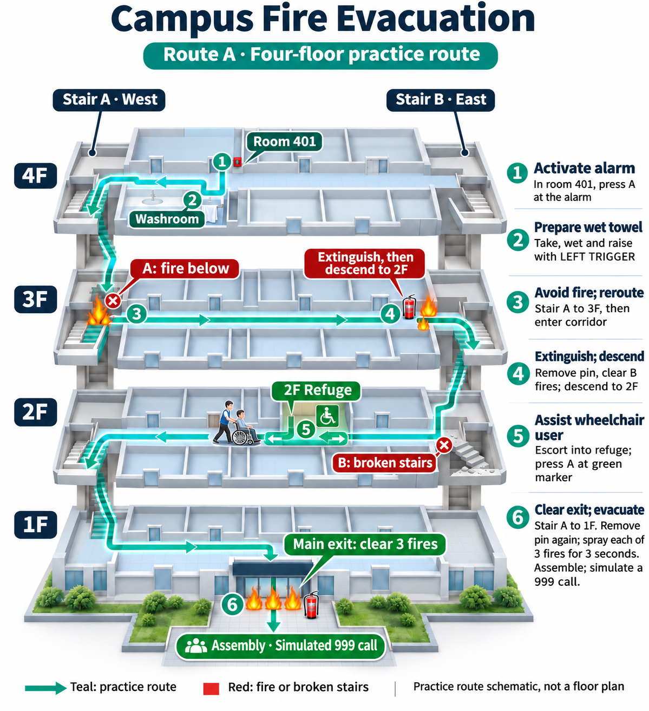

## Major update and integration — 20 November 2026

The current source integrates the full six-node XR journey, virtual hands and simplified left-hand equipment controls, ray-teleport wheelchair escort, a cleared refuge with a wider linked double door and explicit parking confirmation, ceiling-bounded smoke and wet-towel passage checks, and three extinguishable fires at the main exit. Re-equipping the extinguisher restores its safety pin. The final debrief now offers **Restart** (reset to 401 and language selection) and **Exit practice**.

All three languages use structured step headings and highlighted button labels, including exit firefighting. Alarm, fire and tap audio are integrated from Effects. Read the **[detailed update record](Docs/Updates/MajorIntegration_2026-11-20.md)** for each change, implementation files, validation evidence, screenshots and rollback guidance.

**Historical integration:** this section records the 20 November source update. Its earlier checks included 192 full-route assertions, 20 exit-fire checks, 16 smoke-passage checks, restart/exit checks and 39 exit-UI checks. See the Phase 3 section above for the current baseline and newer regression results.

## Experience overview

1. Select English, Simplified Chinese or Traditional Chinese, read the fixed Route A introduction, route map and controller guide, and begin in fourth-floor classroom 401.
2. Use teleportation and snap turning to navigate the building. Follow exit signs, the floor trail and scene-anchored instruction cards toward the current objective.
3. Explore facility interactions: activate an alarm, open doors, pick up and wet a towel, or use an extinguisher when appropriate to the practice situation. The route records its required interaction and location checkpoints; these records do not assess real-world competence.
4. Respond to smoke and fire cues, choose a usable route and reach the outdoor assembly point. Active fire zones prevent teleport rays from crossing them; extinguishing a fire clears its zone.
5. The source tracks six Route A nodes: alarm, raised wet towel, Stair A to 3F, B-side firefighting and descent to 2F, wheelchair assistance into the 2F refuge, then Stair A to 1F, exit firefighting and assembly. The main entrance is the default exit; cleared side exits also support completion. The simulated 999 call leads to a six-step illustrated educational debrief with restart/exit buttons; no real call is placed. The downloadable ZIP predates these source changes.

## Download and run

**[Download the Windows x64 PC VR ZIP](https://github.com/RudeusLin/2026PolyU_COMP5424_Group3_CampusEmergencyPreparedness_VR/raw/refs/heads/main/Phase2_Deliverables/Campus_XR_Effects_Cleaned_Windows.zip)** (approximately 51.63 MiB). No Unity Editor is required to run this package.

1. Use a Windows PC configured for Quest Link or Air Link, with the Meta Quest Link application and Quest 3 controllers ready. This package is a PC VR executable, not an Android APK.
2. Download and fully extract the ZIP. Open the extracted `Campus_XR` folder; do not launch the executable from inside the archive.
3. Connect the headset, enter the Link environment, and set Meta Quest Link as the active OpenXR runtime.
4. Run `Campus_XR.exe`. Keep `Campus_XR_Data`, `MonoBleedingEdge`, `UnityPlayer.dll` and the other supplied files beside it.
5. Select a language, preview a route and start. To repeat the practice from its initial state, close and relaunch the application.

The download was rebuilt from an earlier project source at commit `fc722e9` using Unity 2022.3.62f3 for Windows x64. The archive passed integrity verification; this rebuild has not undergone a new headset test. The [SHA-256 checksum](Phase2_Deliverables/Campus_XR_Effects_Cleaned_Windows.zip.sha256) is provided for download verification. See [PC VR setup](Docs/Quest3PCVRSetup.md) for connection details. PQ604A/B/C hardware compatibility and performance still require on-site verification.

## Feature status

| Feature | Current implementation | Remaining limits or checks |
| --- | --- | --- |
| Quest 3 locomotion | Right-trigger teleport, connected-stair checks, 30° snap turning and 401 rear-centre spawn | Updated source accepted by the project owner; complete packaged headset workflow still needs testing |
| Extinguisher | Left-hand pickup, pin removal on every re-equip and three-second continuous suppression | Simplified simulation; fires disappear immediately and extinguishing agent is unlimited |
| Towel and facilities | Left-hand towel with wetting and toggle-to-raise controls; doors, taps and alarm interaction | Physical protective effects are not simulated |
| Language and route introduction | Three languages; route images, startup controller guide and illustrated review | Full English UI review and participant readability retest remain pending |
| Directional guidance | Floor trail, wall-aligned cards, frames, peripheral cues and side-exit outdoor guidance | Next-step/completion explanations need further review and retesting |
| Smoke and fire | Ceiling-bounded smoke, wet-raised-towel check on 4F and three-fire gates at the main and both side exits | No smoke physiology or damage model; fire regions do not constrain physical headset movement |
| Completion and feedback | Six recorded nodes, guarded assembly arrival, simulated 999 entry and illustrated six-step educational debrief | Records cover interactions/checkpoints; gaze and real-world competence are not measured |
| Session and accessibility support | 401 start gate, wider refuge double door, ray escort, floor/arrow A-confirm parking and debrief restart/exit | Wheelchair appearance, participant retest and packaged comfort/restart/exit checks remain pending |

## Validation and known limitations

| Evidence level | Recorded result |
| --- | --- |
| Windows build | Unity 2022.3.62f3 Windows x64 build succeeded after scene cleanup |
| Package integrity | 155 packaged files passed archive and content checks |
| Dependency safety | 779 recursive dependencies checked across retained scenes; 769 retained asset files unchanged |
| Editor and simulated controllers | Reports cover input, teleportation, extinguisher and towel interactions; these are not substitutes for headset testing |
| Initial user feedback | Five anonymous questionnaires informed Phase 3 priorities; the owner separately accepted the implemented updates |
| PQ604A/B/C and retesting | Target-PC performance, the updated packaged headset journey and formal post-change participant retesting remain unverified |

The prototype supports practice rather than formal assessment. The current source records six-node progress and handles indoor towel recovery without erasing completed nodes. Headset readability, comfort, smoke visibility and performance remain evaluation priorities. Some linked reports record earlier control schemes, including hold-to-raise towel input; they are historical evidence, not validation of the current toggle behaviour. See [controller checks](Docs/ControllerValidation.txt), [towel checks](Docs/XRTowelValidation.txt), [extinguisher checks](Docs/ExtinguisherValidation.txt) and [cleanup validation](Docs/LegacySceneCleanup.md).

## Campus_XR (main branch)

Open `Assets/Scenes/TeachingBuildingCampusXR.unity` in Unity **2022.3.62f3**. This version runs on Windows with Quest 3 through Quest Link or Air Link and OpenXR. See [PC VR setup](Docs/Quest3PCVRSetup.md).

The saved XR scene includes curved furniture, refined restroom fixtures, softer interior finishes and baked room reflections. See the [interactive before/after comparison](Docs/Previews/XRVisualUpgrade/index.html) and [visual upgrade notes](Docs/CampusXRVisualUpgrade.md). Existing global lighting is retained; a full lighting rebake and headset performance checks remain outstanding. These source updates are not included in the downloadable ZIP above.

The keyboard/mouse scene, `Assets/Scenes/TeachingBuildingCampus.unity`, now includes the same furniture, restroom and material refinements; see its [separate before/after comparison](Docs/Previews/DesktopVisualUpgrade/index.html). Stop Play mode and reopen the scene to load saved visual updates. Use **Campus Emergency → Refine desktop models and materials** to reapply them.

The player starts at the rear centre of fourth-floor classroom 401. Aim the right-hand ray at a valid green destination and press the **right trigger** to teleport. **A** interacts with doors, towels and taps; the **right stick** turns by 30 degrees; **left X** switches items, **left trigger** uses the equipped item and **left Y** toggles help. See [all controls](Docs/XRControls.md) and [locomotion implementation](Docs/XRLocomotion.md).

Editor and simulated-controller validation reports are in `Docs`. The current teleport behavior has also been confirmed working by the project owner on the headset.

### Fire extinguisher controls

Switch to empty hands with **left X**, then aim with the right ray and press **A** to acquire an extinguisher in the left hand. Aim the right ray at its yellow pin and press **A** to remove it. Aim the left nozzle at the fire base and hold **left trigger** continuously for **3 seconds**. Releasing, missing, changing target or switching equipment resets progress. **Right trigger always teleports**. X stows/re-equips items while preserving towel wetness. Each re-equip restores the extinguisher pin, which must be removed again with right A. No return or B-mode step is required. At the main entrance or either side exit, extinguish all three fires at that exit before proceeding to the assembly point.

### Open in Unity

1. Check out the `main` branch and open the project in Unity **2022.3.62f3**. Allow Unity to restore the packages recorded in `Packages/manifest.json` and `Packages/packages-lock.json`.
2. Connect Quest 3 through Quest Link or Air Link and enter the Link environment. Use Meta Quest Link as the active OpenXR runtime.
3. Open `Assets/Scenes/TeachingBuildingCampusXR.unity` and enter Play mode. This is also the enabled build scene for the Windows XR version.
4. The player starts at classroom 401 on the fourth floor; no keyboard shortcut is required.

This project targets Windows PC VR, not a standalone Android build. The PC VR setup document records the initial dependency-installation stage; its earlier scene-implementation limitations have since been superseded by the current XR scene.

### Quest 3 controls

| Input | Action |
|---|---|
| Right trigger | Teleport |
| Right A | Scene/UI interaction, pickup, aimed pin removal, wheelchair assistance |
| Right stick left/right | Snap turn 30 degrees |
| Left X | Cycle acquired items: empty → towel → extinguisher → empty |
| Left trigger | Toggle wet towel cover, or hold to spray equipped extinguisher |
| Left Y / keyboard H | Toggle HUD |
| Right B | Pause menu: continue, restart or exit (confirmation for restart/exit) |
| Grips, left stick | No core gameplay binding |

Items occupy the left hand. Extinguisher pickup requires empty hands. Towel wetness persists and the towel re-equips lowered; the extinguisher pin resets on every re-equip. Equipment switching is suspended during wheelchair escort and resumes after pause/delivery. See [current controls](Docs/XRControls.md).

## Directional guidance

A green floor trail connects the tracked player position to the current Route A objective. Wall-aligned task and door cards show the next interaction, with teal frames and a peripheral cue; exterior routes use signboards. The head-relative display shows status and can be toggled with **left Y** or **H**. The floor path avoids unsupported surfaces, obstacles and active fire zones. Teleport destinations still pass the independent safety checks.

The route descends Stair A from 4F to 3F, clears the B-side fires and descends Stair B to 2F. Escort the wheelchair user into the refuge and confirm parking with **right A**, then follow guidance to Stair A and the ground-floor main entrance. The broken B-side 2F–1F flight remains blocked. Alternatively, extinguish the three fires at a side exit and cross outward to receive assembly-point guidance. Clearing side-exit fires alone does not switch the route. Completed nodes remain recorded during towel recovery.

Guidance clarity and comfort require headset evaluation. The direction-arrow screenshot below records the earlier display and is not a preview of the current floor trail.

## Purpose of smoke and fire effects

Smoke on the fourth floor and at other locations, together with visible flames, establishes the evacuation scenario. These cues provide situations for observing hazard recognition, route choice and responses to blocked passages during practice. They do not automatically score evacuation competence.

Smoke is a visual effect. Active fire regions separately reject teleport confirmation when a ray touches or crosses them; they have no physical collision body and do not stop room-scale headset movement. Three seconds of continuous spray on the same fire base extinguishes that fire and clears its teleport restriction. This does not imply that all independently placed corridor smoke disappears.

The prototype does not simulate heat injury, smoke inhalation, realistic fire spread or the protective effectiveness of a wet towel. Effect intensity, visibility, comfort and performance still require evaluation on the target headset and PCs.

## Screenshots

Historical captures from the XR scene in Unity Play Mode at 1600 × 900, before the UI branch changes. These are Editor-rendered previews, not headset recordings. Held-item poses and the spray state were staged using the project's existing models and visual logic; they illustrate appearance, not end-to-end controller validation. Click an image to view it at full resolution.

### Campus environment

| Classroom 401 starting view | Corridor smoke |
| --- | --- |
| 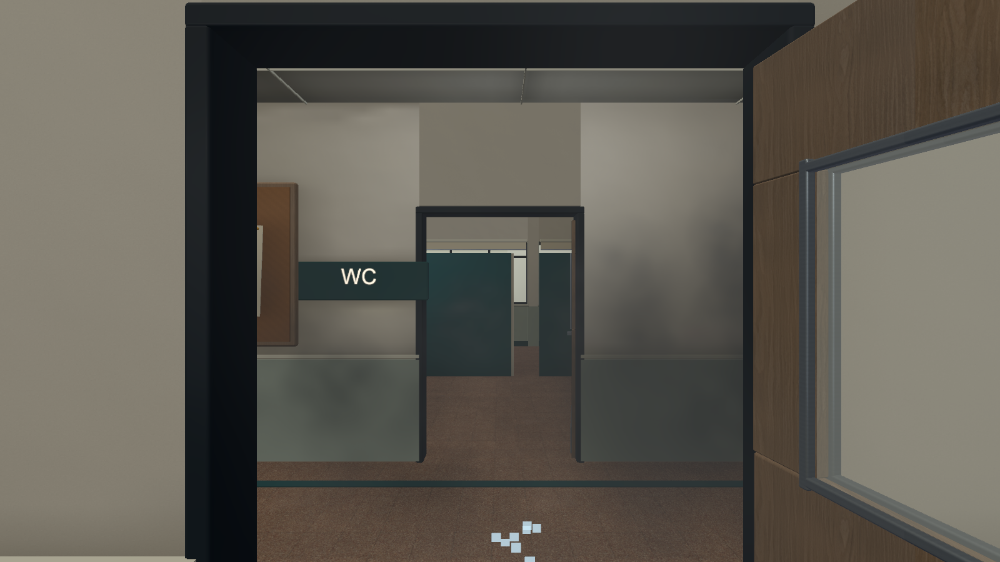 | 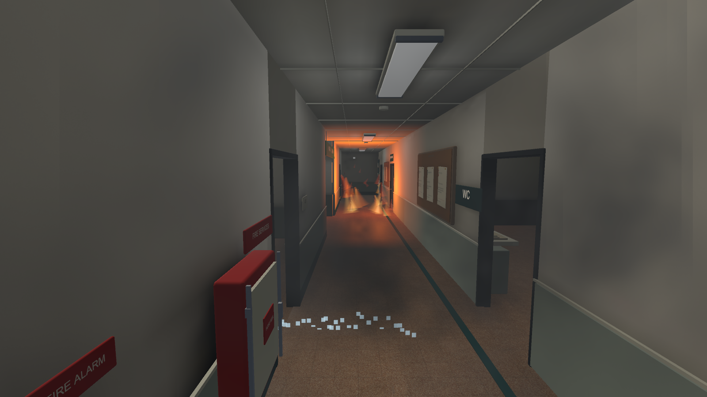 |

| Indoor fire | Extinguisher station |
| --- | --- |
| 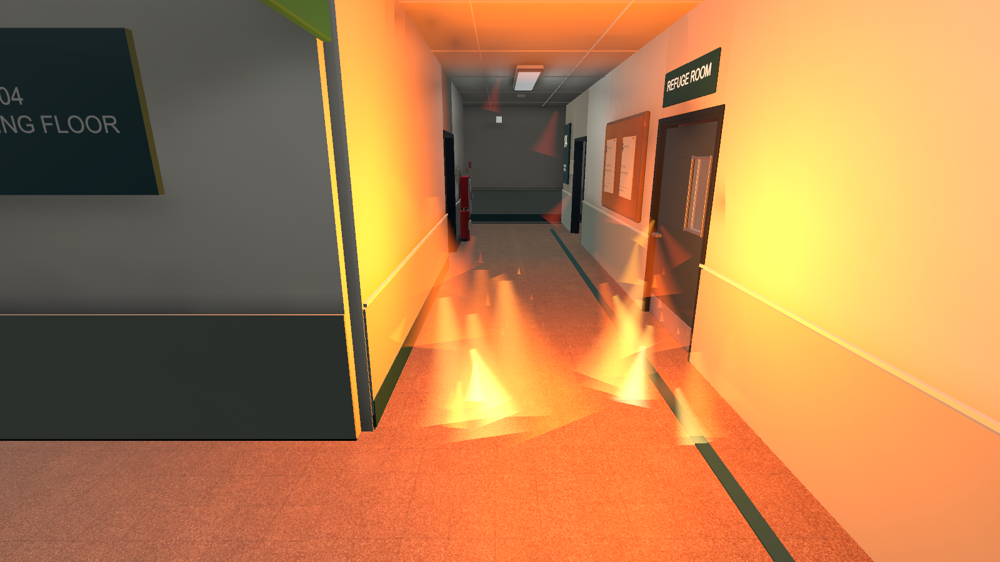 | 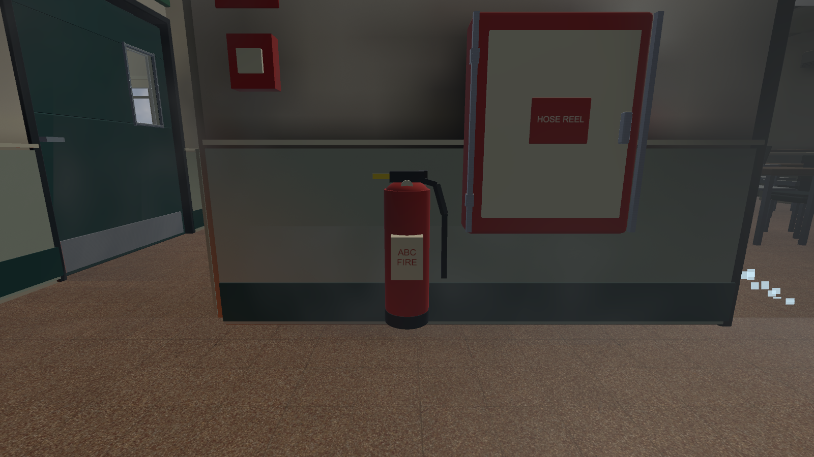 |

| Held extinguisher with pin removed | Outdoor assembly point |
| --- | --- |
| 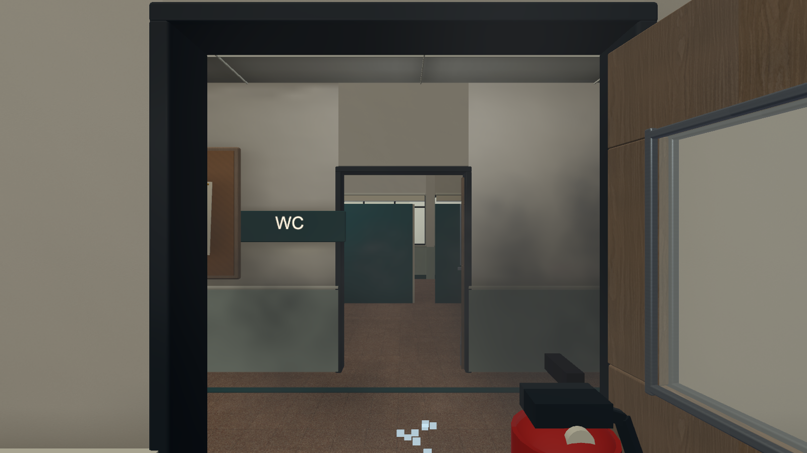 | 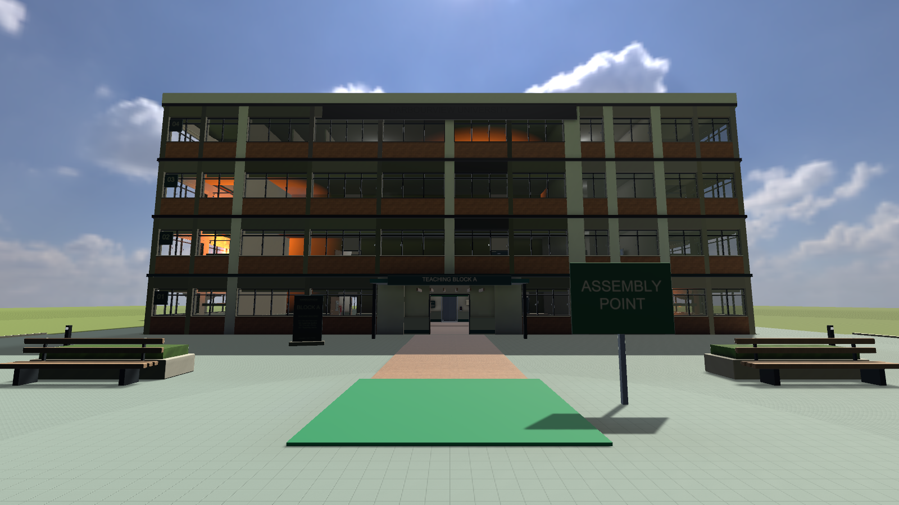 |

### Interaction and guidance previews

| Wet towel held in the left hand | Wet towel raised below the central view |
| --- | --- |
| 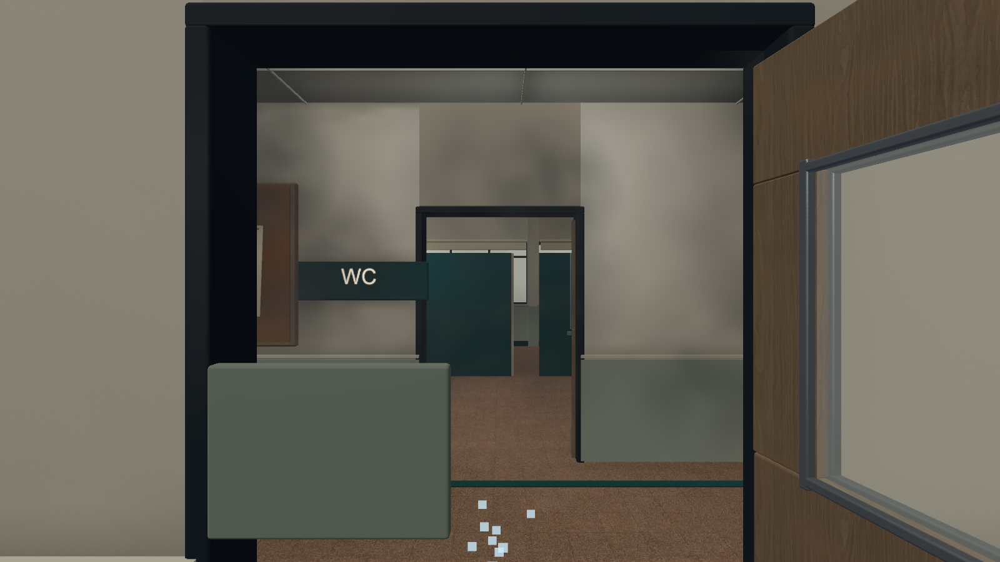 | 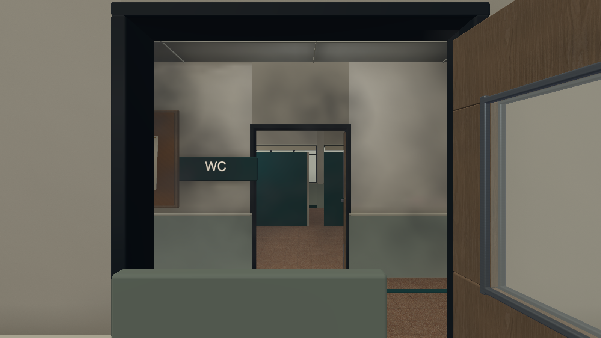 |

| Direction arrow and distance indicator | Extinguisher spray at the fire base |
| --- | --- |
| 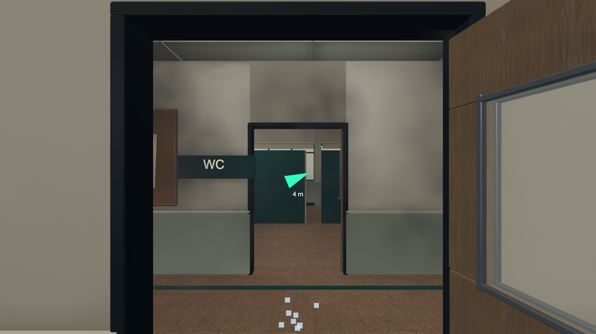 | 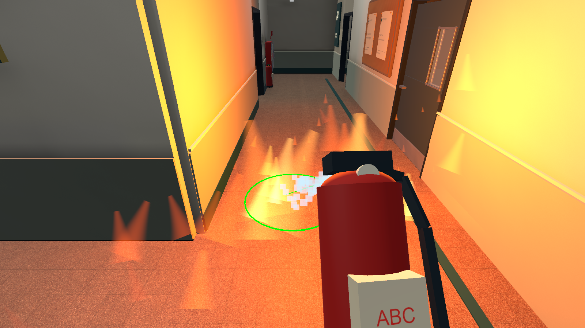 |

## Current campus scene (desktop controls)

Open `Assets/Scenes/TeachingBuildingCampus.unity` in Unity **2022.3.62f3**. This is the current campus environment, with scanned PBR surfaces, HDRI daylight, classroom furniture, physical signage, noticeboards, an articulated student and an optional localized smoke/alarm preview. Use **WASD** to move, **F4/F2** to select floor starting positions, **Shift** to run, **Space** to jump and **V** to switch first/third person. Movement accelerates and brakes smoothly, with distinct walk/run, airborne and landing poses. First person shows animated sleeves and detailed hands; held towels follow the right hand in either view. Both evacuation routes support tested desktop stair ascent/descent. The keyboard controls in this section apply to the desktop scene; use the XR scene and controller mapping above for Quest 3. Headset performance has not been benchmarked.

The fourth-floor WC is now opposite classroom 401, with room 403 in the former WC space. All four floors have a basin, mirror, working tap and pickup towel, plus a signed refuge room with a distinct door finish. Press **E** to pick up a towel and use the tap to wet it; **R** restores the towel and turns off all taps. The standalone viewer includes washroom and refuge-room views. See `CampusModelingValidation.txt` and `CampusModelingGeneratorValidation.txt` in `Docs/Previews/Campus` for the corresponding checks.

Open [the standalone campus preview](Docs/Previews/Campus/TeachingBuildingCampusPreview.html) without Unity, or read [campus scene instructions](Docs/TeachingBuildingCampus.md). Desktop campus captures and validation reports are in `Docs/Previews/Campus`; historical XR screenshots are in `Docs/Previews/XR`; earlier material comparisons are in `Docs/Previews/Campus/History`.

The layout generator and standalone preview include a further lighting and floor-wayfinding pass. This pass has **not yet been applied to the saved Unity scene or baked lighting**; it was prepared while the local Editor license was unavailable. To apply it, run `python Tools/campus_scene_polish.py` and choose **Campus Emergency → Apply campus scene polish**. See the campus instructions for the delivery scope and checks.

The saved campus scene, `CampusStudent.prefab`, generator and viewer now use the **Microsoft Rocketbox Male_Adult_08** character: lighter skin, brushed-back hair, shirt and trousers, no backpack, and a complete skinned mesh with face/clothing textures. See the [actual Unity character](Docs/Previews/Campus/Campus-Student.png), [first-person hands](Docs/Previews/Campus/Campus-Hands.png), or the [browser model comparison](Docs/Previews/Campus/Student/Rocketbox/Student-Comparison.png). Original FBX, converted 1K textures, provenance and the MIT notice are included under `Assets/ThirdParty/Rocketbox`; no modeling application or extra Unity package is required. **Campus Emergency → Update campus student appearance** reapplies the character. Actual FBX import, saved-scene desktop Play Mode movement/jump, first-person hands/towel, camera toggles and all ten evacuation-route checks pass. The dynamic character reuses existing building lighting. Headset input, stereo comfort and performance remain unverified.

## Earlier scene versions

- **Prototype:** `Assets/Scenes/TeachingBuilding.unity`; [instructions](Docs/TeachingBuildingPrototype.md), [browser preview](Docs/Previews/TeachingBuildingPreview.html).
- **Refined:** `Assets/Scenes/TeachingBuildingRefined.unity`; [instructions](Docs/TeachingBuildingRefined.md), [rendering fixes](Docs/TeachingBuildingRenderingAudit.md), [browser preview](Docs/Previews/Refined/TeachingBuildingRefinedPreview.html).

The Prototype and Refined scene files have been removed from the active checkout; their history remains in Git. The links above describe historical versions. Restore the scenes from commit 3c058a6 before opening them, or explicitly rebuild them from Campus Emergency > Legacy. Campus and XR remain available. Shared textures, models, scene lighting folders and generation helpers are retained. See [scene cleanup](Docs/LegacySceneCleanup.md).

## Weekly activity record

See the [weekly activity record](Docs/WeeklyActivityRecord.md) or download its [PDF version](Phase2_Deliverables/WeeklyActivityRecord.pdf) for 21 September–18 October 2026.

## Project maintenance

See [file organization and cleanup](Docs/ProjectFileAudit.md) and [the cleanup record](Docs/ProjectCleanupCandidates.json). Unity caches, logs and generated IDE project files are excluded by `.gitignore`.

## Team Members

|     Name     |  StudentID  | GitHub Account |
| --- | --- | --- |
| Lin Zhiwei   |  26105448g  | RudeusLin      |  
| Fu  Jiahao   |  26062063g  | FJH-123123     |  
| Li  Yisheng  |  26124143g  | LiYS-08        |  
| Liu Tianran  |  26039772g  | LTR132322      |  
| Mo  Jiangwei |  26104251g  | MoooJianG      |
