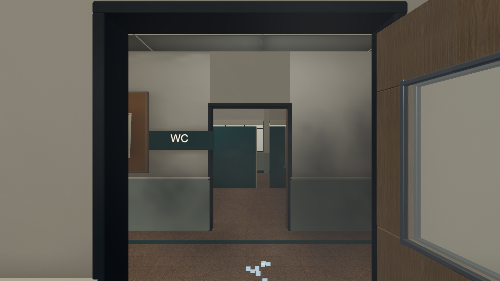
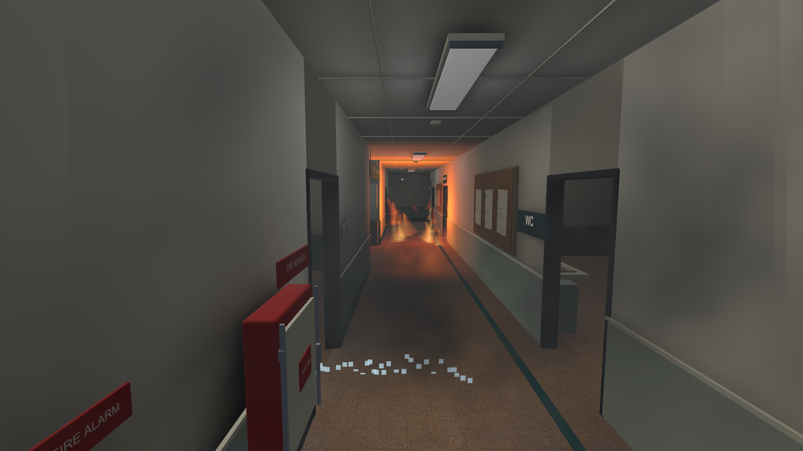
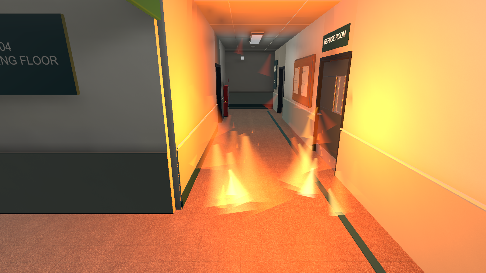
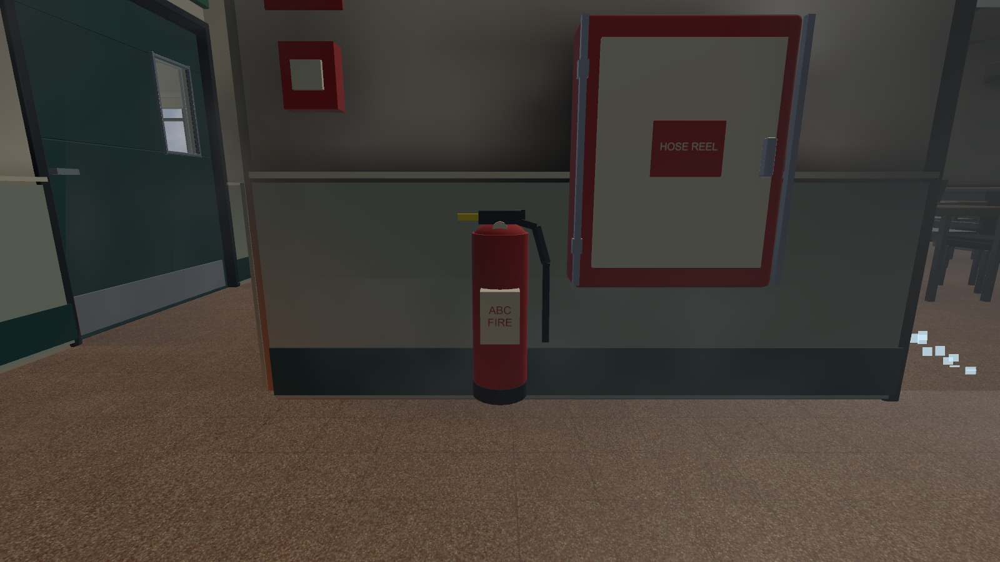
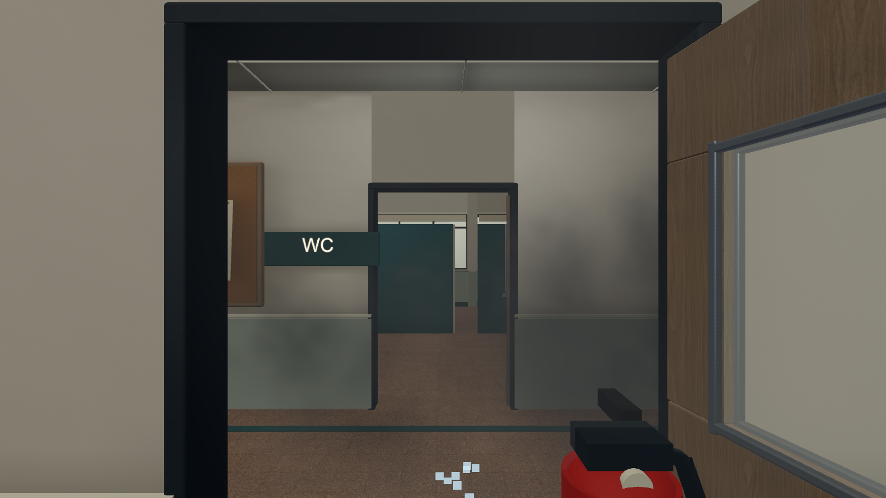
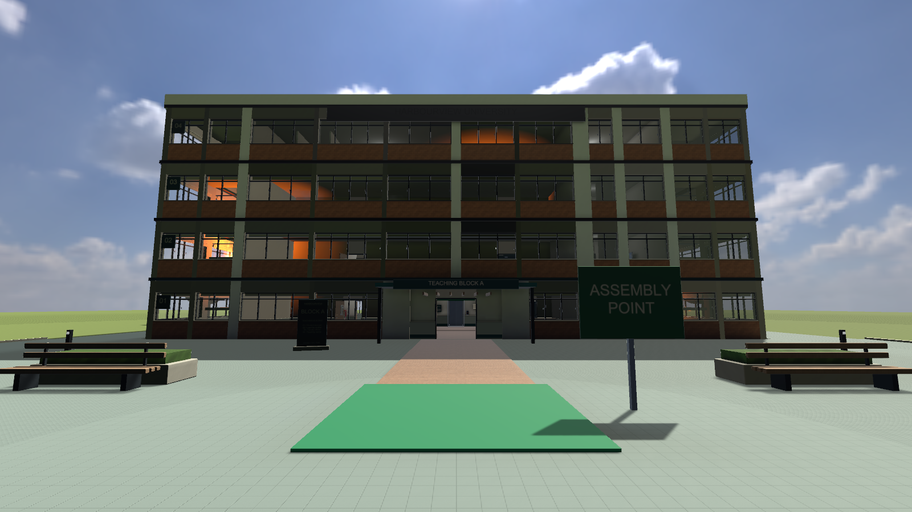
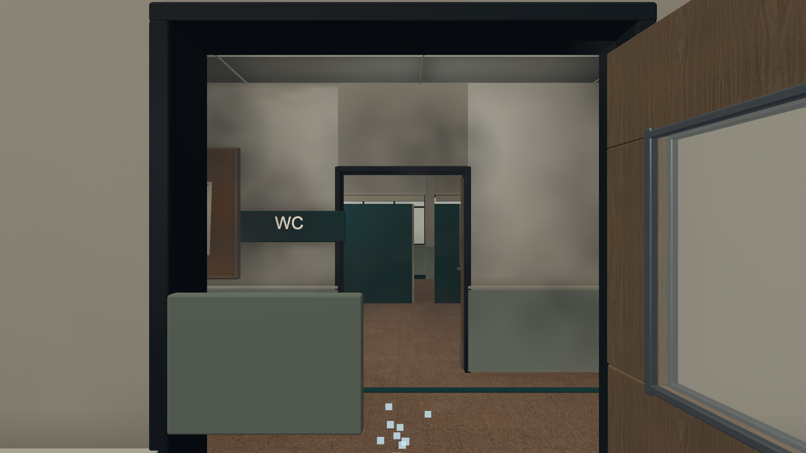
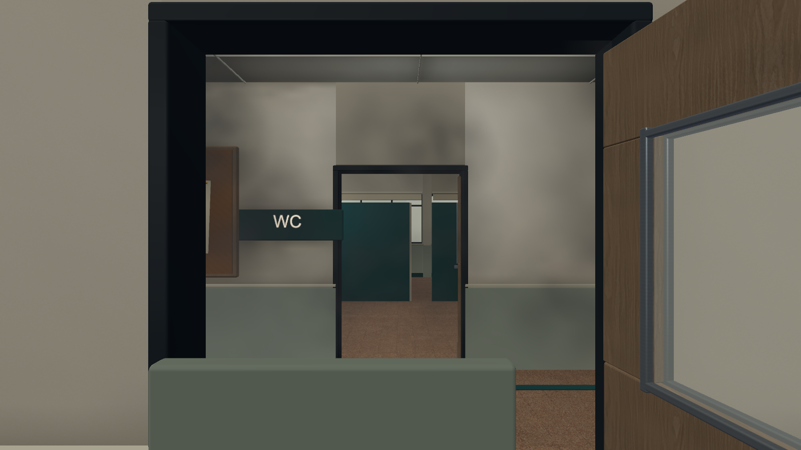
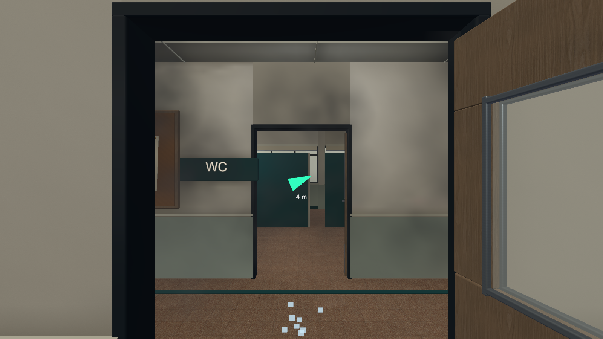
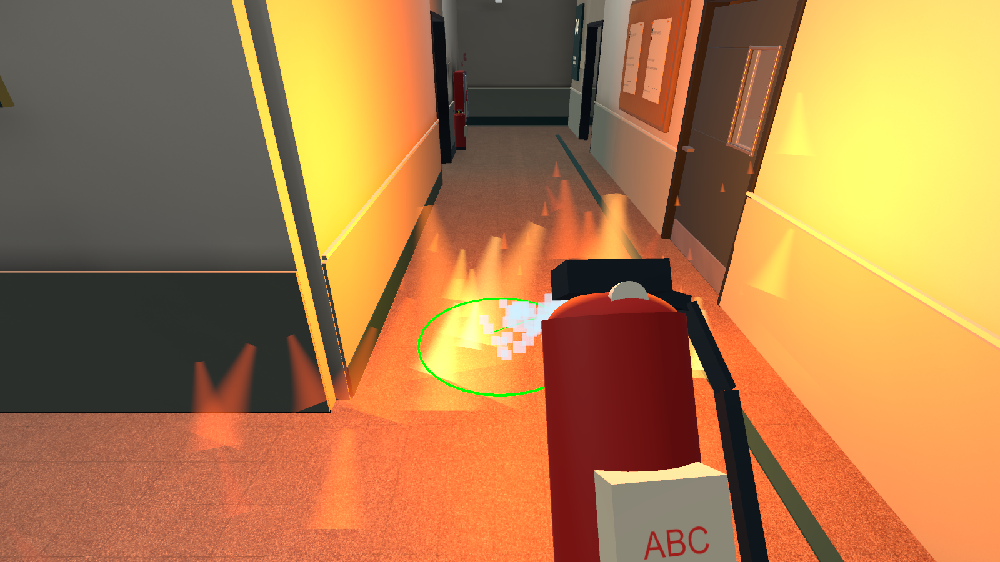

# COMP5424 Group 3 — Campus Emergency Preparedness

A VR fire evacuation preparedness practice prototype for international students at fictional Harbourview University. The experience supports practice rather than formal assessment and does not replace official emergency training.

## Experience overview

1. Select English, Simplified Chinese or Traditional Chinese, preview Route A or B, and begin in fourth-floor classroom 401.
2. Use teleportation and snap turning to navigate the building. Follow exit signs, the directional arrow and the target beacon toward the current objective.
3. Explore facility interactions: activate an alarm, open doors, pick up and wet a towel, or use an extinguisher when appropriate to the practice situation. These interactions are available for practice; completion does not verify that every step was performed.
4. Respond to smoke and fire cues, choose a usable route and reach the outdoor assembly point. Active fire zones prevent teleport rays from crossing them; extinguishing a fire clears its zone.
5. Arrival starts a simulated telephone task. Entering 999 opens a static debrief; no real call is placed. The debrief reflects the route selected in the menu, not a measured record of the route taken.

## Download and run

**[Download the Windows x64 PC VR ZIP](https://github.com/RudeusLin/2026PolyU_COMP5424_Group3_CampusEmergencyPreparedness_VR/raw/refs/heads/main/Deliverables/Campus_XR_Effects_Cleaned_Windows.zip)** (approximately 52.45 MiB). No Unity Editor is required to run this package.

1. Use a Windows PC configured for Quest Link or Air Link, with the Meta Quest Link application and Quest 3 controllers ready. This package is a PC VR executable, not an Android APK.
2. Download and fully extract the ZIP. Open the extracted `Campus_XR` folder; do not launch the executable from inside the archive.
3. Connect the headset, enter the Link environment, and set Meta Quest Link as the active OpenXR runtime.
4. Run `Campus_XR.exe`. Keep `Campus_XR_Data`, `MonoBleedingEdge`, `UnityPlayer.dll` and the other supplied files beside it.
5. Select a language, preview a route and start. To repeat the practice from its initial state, close and relaunch the application.

The download contains the previously validated Effects build with Windows compilation fixes and legacy scene cleanup. Later README and weekly-record edits do not change its gameplay. The [SHA-256 checksum](Deliverables/Campus_XR_Effects_Cleaned_Windows.zip.sha256) is provided for download verification. See [PC VR setup](Docs/Quest3PCVRSetup.md) for connection details. PQ604A/B/C hardware compatibility and performance still require on-site verification.

## Feature status

| Feature | Current implementation | Remaining limits or checks |
| --- | --- | --- |
| Quest 3 locomotion | Right-trigger teleport, 30-degree snap turning and classroom 401 spawn | Basic teleport confirmed by the project owner; complete packaged headset workflow still needs testing |
| Extinguisher | Pickup, pin removal, Action/Spray switching and three-second continuous suppression | Simplified simulation; no gradual suppression or limited agent supply |
| Towel and facilities | Left-hand towel, wetting and raising; doors, taps and alarm interaction | Physical protective effects are not simulated |
| Language and route selection | English, Simplified Chinese and Traditional Chinese; A/B route previews | Long translated prompts and font rendering require headset checks |
| Directional guidance | Head-relative arrow and world-space objective beacon | Clarity, obstruction and reliance on guidance need user evaluation |
| Smoke and fire | Smoke on the fourth floor and elsewhere; fire effects and teleport restrictions | No smoke physiology or damage model; fire regions do not constrain physical headset movement |
| Completion and feedback | Assembly-point detection, simulated 999 entry and static debrief | Partial: no verified action-by-action progress, actual-route logging or personalised debrief |
| Session and accessibility support | Session scripts, prompts and a modelled refuge room | Full reset/replay, consent flow and assisted-evacuation procedures remain incomplete |

## Validation and known limitations

| Evidence level | Recorded result |
| --- | --- |
| Windows build | Unity 2022.3.62f3 Windows x64 build succeeded after scene cleanup |
| Package integrity | 155 packaged files passed archive and content checks |
| Dependency safety | 779 recursive dependencies checked across retained scenes; 769 retained asset files unchanged |
| Editor and simulated controllers | Reports cover input, teleportation, extinguisher and towel interactions; these are not substitutes for headset testing |
| User headset feedback | The project owner confirmed basic teleportation and provided feedback during interaction iterations; this is not a controlled user study |
| PQ604A/B/C and evaluation | Target-PC performance, the full packaged headset journey and formal participant evaluation remain unverified |

The prototype supports practice rather than formal assessment. Current objective prompts can recur based on the held item; the static debrief does not establish that every task was completed. Headset readability, comfort, smoke visibility and performance remain evaluation priorities. See [controller checks](Docs/ControllerValidation.txt), [towel checks](Docs/XRTowelValidation.txt), [extinguisher checks](Docs/ExtinguisherValidation.txt) and [cleanup validation](Docs/LegacySceneCleanup.md).

## Campus_XR (main branch)

Open `Assets/Scenes/TeachingBuildingCampusXR.unity` in Unity **2022.3.62f3**. This version runs on Windows with Quest 3 through Quest Link or Air Link and OpenXR. See [PC VR setup](Docs/Quest3PCVRSetup.md).

The player starts at the fourth-floor classroom 401 spawn. Aim the right-hand ray at a valid green destination and press the **right trigger** to teleport. **A** interacts with doors, towels and taps; the **right stick** turns by 30 degrees; the **right grip** returns the towel; holding the **left grip** suspends teleport aiming. See [all controls](Docs/XRControls.md) and [locomotion implementation](Docs/XRLocomotion.md).

Editor and simulated-controller validation reports are in `Docs`. The current teleport behavior has also been confirmed working by the project owner on the headset.

### Fire extinguisher controls

**Pick up → pull the pin → aim at the fire base → spray for 3 seconds.**

| Input | Function |
| --- | --- |
| Right **A** | Pick up an extinguisher |
| Left **grip** near the yellow pin (within 18 cm) | Remove the safety pin |
| Right **B** | Switch **Action ↔ Spray** mode; release the trigger after switching |
| Right **trigger** in Action mode | Teleport while carrying the extinguisher |
| Hold right **trigger** in Spray mode | Spray at the fire base within 3 m; green aim confirms a target |
| Right **grip** | Return the extinguisher and reset its pin; release the trigger first |

Hit the **same fire continuously for 3 seconds** to extinguish it immediately. Releasing, missing or switching targets resets progress. A teleport ray touching or crossing a live fire zone cannot confirm movement; extinguishing clears that zone. Towels and extinguishers cannot be carried together. [Full workflow and rollback](Docs/ExtinguisherWorkflow.md).

### Open in Unity

1. Check out the `main` branch and open the project in Unity **2022.3.62f3**. Allow Unity to restore the packages recorded in `Packages/manifest.json` and `Packages/packages-lock.json`.
2. Connect Quest 3 through Quest Link or Air Link and enter the Link environment. Use Meta Quest Link as the active OpenXR runtime.
3. Open `Assets/Scenes/TeachingBuildingCampusXR.unity` and enter Play mode. This is also the enabled build scene for the Windows XR version.
4. The player starts at classroom 401 on the fourth floor; no keyboard shortcut is required.

This project targets Windows PC VR, not a standalone Android build. The PC VR setup document records the initial dependency-installation stage; its earlier scene-implementation limitations have since been superseded by the current XR scene.

### Quest 3 controls

| Input | Action |
| --- | --- |
| Aim the right controller | Point the teleport ray at a destination |
| Right trigger | Press to teleport to a green destination; holding does not repeat and releasing does not teleport |
| Right A button | Interact with doors, towels and taps; holding displays the short-range interaction ray |
| Right stick left/right | Turn by 30 degrees; return to center before turning again |
| Right grip | Return the held towel to its original counter |
| Left trigger | Hold to raise the left-hand towel below the central view; release to lower |
| Left X / keyboard H | Show or hide the instruction panel |
| Left grip | Hold to suspend teleport aiming; release to resume |
| Head movement | Look around using headset tracking |

Green indicates a valid landing point; red indicates an invalid target. Teleportation checks obstructions, support and headroom, with a maximum ray distance of 12 metres and a maximum height difference of 4 metres. After tracking or application focus is restored, release the trigger before pressing it again. Holding the trigger pauses turning and towel return. Left grip suspension applies when not carrying an extinguisher. B switches modes while carrying an extinguisher. Left stick and Y have no campus gameplay bindings; system buttons retain their normal functions. See [left-hand towel controls](Docs/XRTowelInteraction.md).

## Screenshots

Captured from the XR scene in Unity Play Mode at 1600 × 900. These are Editor-rendered previews, not headset recordings. Held-item poses and the spray state were staged using the project's existing models and visual logic; they illustrate appearance, not end-to-end controller validation. Click an image to view it at full resolution.

### Campus environment

| Classroom 401 starting view | Corridor smoke |
| --- | --- |
|  |  |

| Indoor fire | Extinguisher station |
| --- | --- |
|  |  |

| Held extinguisher with pin removed | Outdoor assembly point |
| --- | --- |
|  |  |

### Interaction and guidance previews

| Wet towel held in the left hand | Wet towel raised below the central view |
| --- | --- |
|  |  |

| Direction arrow and distance indicator | Extinguisher spray at the fire base |
| --- | --- |
|  |  |

## Current campus scene (desktop controls)

Open `Assets/Scenes/TeachingBuildingCampus.unity` in Unity **2022.3.62f3**. This is the current campus environment, with scanned PBR surfaces, HDRI daylight, classroom furniture, physical signage, noticeboards, an articulated student and an optional localized smoke/alarm preview. Press **F4/F2** to walk, **Shift** to run, **Space** to jump and **V** to switch first/third person. Movement accelerates and brakes smoothly, with distinct walk/run, airborne and landing poses. First person shows animated sleeves and detailed hands; held towels follow the right hand in either view. Both evacuation routes support tested desktop stair ascent/descent. The keyboard controls below apply to the desktop scene; use the XR scene and controller mapping above for Quest 3. Headset performance has not been benchmarked.

The fourth-floor WC is now opposite classroom 401, with room 403 in the former WC space. All four floors have a basin, mirror, working tap and pickup towel, plus a signed refuge room with a distinct door finish. Press **E** to pick up a towel and use the tap to wet it; **R** restores the towel and turns off all taps. The standalone viewer includes washroom and refuge-room views. See `CampusModelingValidation.txt` and `CampusModelingGeneratorValidation.txt` in `Docs/Previews/Campus` for the corresponding checks.

Open [the standalone campus preview](Docs/Previews/Campus/TeachingBuildingCampusPreview.html) without Unity, or read [campus scene instructions](Docs/TeachingBuildingCampus.md). Current Unity captures and validation reports are in `Docs/Previews/Campus`; earlier material comparisons are in `Docs/Previews/Campus/History`.

## Earlier scene versions

- **Prototype:** `Assets/Scenes/TeachingBuilding.unity`; [instructions](Docs/TeachingBuildingPrototype.md), [browser preview](Docs/Previews/TeachingBuildingPreview.html).
- **Refined:** `Assets/Scenes/TeachingBuildingRefined.unity`; [instructions](Docs/TeachingBuildingRefined.md), [rendering fixes](Docs/TeachingBuildingRenderingAudit.md), [browser preview](Docs/Previews/Refined/TeachingBuildingRefinedPreview.html).

The Prototype and Refined scene files have been removed from the active checkout; their history remains in Git. The links above describe historical versions. Restore the scenes from commit 3c058a6 before opening them, or explicitly rebuild them from Campus Emergency > Legacy. Campus and XR remain available. Shared textures, models, scene lighting folders and generation helpers are retained. See [scene cleanup](Docs/LegacySceneCleanup.md).

## Weekly activity record

See the [weekly activity record](Docs/WeeklyActivityRecord.md) or download its [PDF version](Docs/WeeklyActivityRecord.pdf) for 21 September–18 October 2026.

## Project maintenance

See [file organization and cleanup](Docs/ProjectFileAudit.md) and [the cleanup record](Docs/ProjectCleanupCandidates.json). Unity caches, logs and generated IDE project files are excluded by `.gitignore`.

## Team Members

|     Name     |  StudentID  | GitHub Account |
| --- | --- | --- |
| Lin Zhiwei   |  26105448g  | RudeusLin      |  
| Fu  Jiahao   |  26062063g  | FJH-123123     |  
| Li  Yisheng  |  26124143g  | LiYS-08        |  
| Liu Tianran  |  26039772g  | LTR132322      |  
| Mo  Jiangwei |  26104251g  | MoooJianG      |
